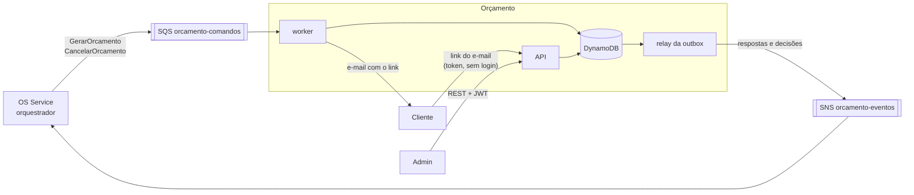
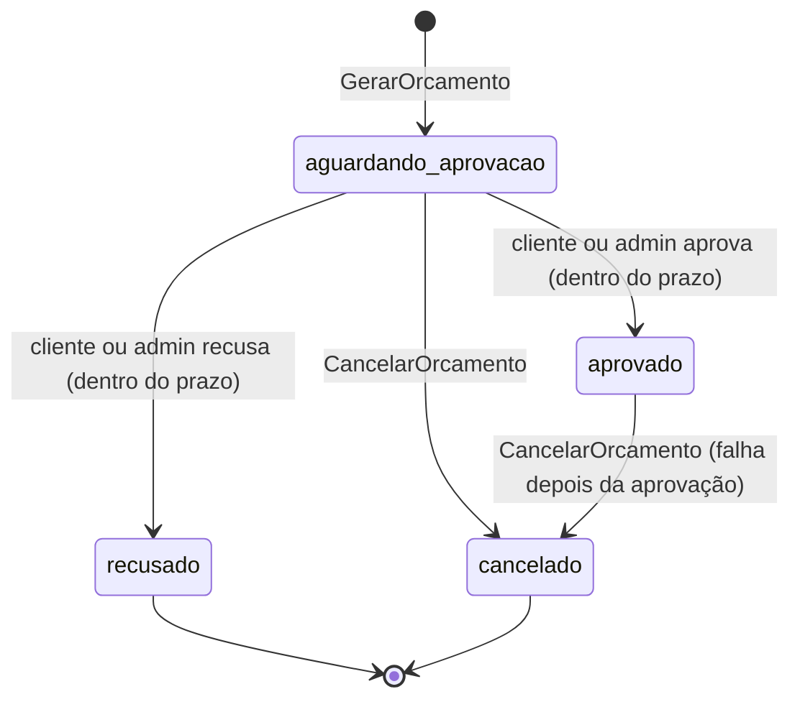

# oficina-mecanica-orcamento

[](https://sonarcloud.io/summary/overall?id=phantosmia_oficina-mecanica-orcamento) [](https://sonarcloud.io/component_measures?id=phantosmia_oficina-mecanica-orcamento&metric=coverage)

Microsserviço de **Orçamento** do sistema da oficina mecânica (Tech Challenge FIAP, Fase 4): monta o orçamento a partir do diagnóstico do mecânico, envia ao cliente um **link de aprovação** e registra a **aprovação ou recusa**, feita pelo cliente (pelo link) ou pelo admin (em nome dele).

É um dos 6 microsserviços do sistema. A divisão, a saga e o contrato entre os serviços estão documentados no repositório principal, [oficina-mecanica-fiap](https://github.com/phantosmia/oficina-mecanica-fiap):

- [RFC-0008: Orçamento e Pagamento como microsserviços separados](https://github.com/phantosmia/oficina-mecanica-fiap/blob/main/docs/rfcs/0008-separacao-orcamento-e-pagamento.md)
- [ADR-0011: Orçamento em DynamoDB](https://github.com/phantosmia/oficina-mecanica-fiap/blob/main/docs/adrs/0011-persistencia-orcamento-e-pagamento.md)
- [ADR-0008](https://github.com/phantosmia/oficina-mecanica-fiap/blob/main/docs/adrs/0008-saga-orquestrada-no-os-service.md) e [ADR-0010](https://github.com/phantosmia/oficina-mecanica-fiap/blob/main/docs/adrs/0010-diagnostico-define-o-orcamento.md): a saga orquestrada
- [`docs/saga.md`: contrato de mensagens entre os serviços](https://github.com/phantosmia/oficina-mecanica-fiap/blob/main/docs/saga.md)

## Papel no sistema



| Recebe (fila `orcamento-comandos`) | Efeito | Responde |
|---|---|---|
| `GerarOrcamento` | Cria o orçamento com os itens do diagnóstico e envia o link de aprovação ao cliente | `OrcamentoGerado` ou `OrcamentoFalhou` |
| `CancelarOrcamento` (compensação) | Cancela o orçamento (aguardando aprovação ou já aprovado); o link deixa de aceitar decisões | `OrcamentoCancelado` (sempre) |

| Publica | Quando |
|---|---|
| `OrcamentoAprovado` | O cliente aprovou pelo link, ou o admin em nome dele. A saga segue para a cobrança |
| `OrcamentoRecusado` | O cliente recusou. A saga libera as peças e encerra a OS como recusada |

### Ciclo de vida do orçamento



## Arquitetura do serviço

Clean Architecture, a mesma organização dos outros serviços:

```
app/
├── quotes/
│   ├── domain/        # Quote (totais, decisões, cancelamento), status, porta do repositório
│   ├── application/   # saga_handlers.py (comandos), use_cases.py (cliente e admin), notifications.py (e-mails)
│   ├── adapters/      # repositório DynamoDB, presenters
│   ├── controller.py  # rotas públicas (/public/quotes) e de admin (/quotes)
│   └── schemas.py
├── messaging/         # dispatcher e consumidor SQS
├── system/            # /health e /ready
├── shared/            # settings, JWT, DynamoDB, envelope, outbox, publicador SNS, e-mail (SMTP), tracing, logs
├── worker.py          # processo consumidor da fila de comandos
└── outbox_relay.py    # processo que publica a outbox no SNS
```

### DynamoDB (*single-table design*)

| Item | `pk` | `gsi1pk` / `gsi1sk` | Para quê |
|---|---|---|---|
| Orçamento (um por OS) | `QUOTE#<order_id>` | `TOKEN#<token>` / `QUOTE` | O documento do orçamento. O GSI1 encontra o orçamento pelo token do link, que é como o cliente chega |
| Mensagem processada | `MSG#<message_id>` | — | Idempotência |
| Saga já compensada | `COMPENSATED#<saga_id>` | — | Ver "mensagens fora de ordem" abaixo |
| Outbox | `OUTBOX#<message_id>` | `OUTBOX` / `<data>#<id>` | Eventos pendentes de publicação |

### Decisões de comportamento

- **Os totais vêm dos itens, nunca do comando.** O orçamento recalcula mão de obra, peças e total a partir de cada item (quantidade × preço copiado do Catálogo no diagnóstico), mesmo que o comando traga totais prontos.
- **O token é a autorização do cliente.** O link `/orcamento/{token}` (e a versão JSON, `/public/quotes/{token}`) não exige login: o token tem 256 bits (`secrets.token_urlsafe(32)`), então não dá para adivinhar. A visão pública não mostra token, e-mail nem IDs internos da saga. Token inexistente e token malformado recebem a mesma resposta (404).
- **Uma decisão só.** Aprovar e recusar só valem com o orçamento aguardando aprovação e dentro do prazo (`QUOTE_VALIDITY_DAYS`). A gravação é condicional ao status: se o cliente aprova pelo link enquanto o admin recusa pela API, só a primeira vale; a segunda recebe 409.
- **E-mail depois do commit, em tentativa única.** Uma falha de SMTP não desfaz o orçamento nem trava a saga. O admin vê o link em `GET /quotes/{order_id}` (`approval_url`) e pode reenviar com `POST /quotes/{order_id}/resend-email`.
- **Mensagens fora de ordem.** Se o `CancelarOrcamento` chega antes do `GerarOrcamento`, o serviço grava que a saga já foi compensada, e a geração atrasada responde `OrcamentoFalhou` (`saga_ja_compensada`). Sem isso, o cliente receberia o link de uma OS já cancelada.
- **Mensagens repetidas.** Reentrega ignorada. Comando reenviado pelo orquestrador responde de novo com o mesmo orçamento, sem mandar outro e-mail.

## API

Swagger em `http://localhost:8004/docs` (docker-compose).

| Método | Rota | Auth | Descrição |
|---|---|---|---|
| `GET` | `/orcamento/{token}` | token | **O link do e-mail**: página HTML com itens, totais, prazo e os botões Aprovar/Recusar |
| `POST` | `/orcamento/{token}/aprovar` · `/recusar` | token | Os botões da página |
| `GET` | `/public/quotes/{token}` | token | O mesmo orçamento em JSON, para uso por API |
| `POST` | `/public/quotes/{token}/approve` | token | O cliente aprova |
| `POST` | `/public/quotes/{token}/reject` | token | O cliente recusa |
| `GET` | `/quotes/{order_id}` | admin | Orçamento da OS, com dados do cliente e o link de aprovação |
| `POST` | `/quotes/{order_id}/approve` | admin | Aprova em nome do cliente (ex.: por telefone) |
| `POST` | `/quotes/{order_id}/reject` | admin | Recusa em nome do cliente |
| `POST` | `/quotes/{order_id}/resend-email` | admin | Reenvia o e-mail com o link (só aguardando aprovação) |
| `GET` | `/health` | — | *Liveness* |
| `GET` | `/ready` | — | *Readiness*: confere acesso à tabela DynamoDB |

As rotas de admin exigem o JWT emitido pelo OS Service. No deploy (`k8s/overlays/aws-academy`), o Service da API é `LoadBalancer`, porque o cliente abre o link de fora do cluster.

## Como rodar

### Docker Compose

```bash
docker compose up --build
```

Sobe LocalStack (DynamoDB, SQS, SNS), **Mailpit** (SMTP de teste), API (`http://localhost:8004`), worker e relay. Os e-mails enviados aparecem na caixa de entrada do Mailpit, em `http://localhost:8025`. O link do e-mail abre a página do orçamento, onde o cliente aprova ou recusa.

Para gerar um token de admin sem subir o OS Service:

```bash
poetry run python -c "from jose import jwt; import time; print(jwt.encode({'sub': 'admin', 'exp': time.time() + 3600}, 'change-me-in-production', algorithm='HS256'))"
```

### Testes

```bash
poetry install
poetry run pytest
```

DynamoDB, SQS e SNS simulados pelo [moto](https://github.com/getmoto/moto); o envio de e-mail é substituído por um *fake* que registra as mensagens. Não precisam de Docker nem de AWS. Cobertura mínima exigida: 80% (`pyproject.toml`).

## Configuração

| Variável | Padrão | Descrição |
|---|---|---|
| `ORCAMENTO_TABLE_NAME` | `oficina-orcamento` | Tabela DynamoDB |
| `ORCAMENTO_COMMANDS_QUEUE_URL` | — | Fila de comandos da saga |
| `ORCAMENTO_EVENTS_TOPIC_ARN` | — | Tópico SNS onde o Orçamento publica |
| `PUBLIC_BASE_URL` | `http://localhost:8004` | Endereço público da API, usado no link enviado ao cliente |
| `QUOTE_VALIDITY_DAYS` | `7` | Prazo para o cliente responder |
| `SMTP_ENABLED` / `SMTP_HOST` / `SMTP_PORT` / `SMTP_FROM` / `SMTP_USERNAME` / `SMTP_PASSWORD` | desabilitado | Envio de e-mail (mesmas variáveis do OS Service) |
| `AWS_REGION` | `us-east-1` | Região AWS |
| `AWS_ENDPOINT_URL` | — | Só local: endpoint do LocalStack |
| `JWT_SECRET_KEY` | `change-me-in-production` | Mesmo segredo do OS Service |
| `ADMIN_USERNAME` | `admin` | `sub` esperado no JWT |
| `WORKER_WAIT_SECONDS` | `10` | *Long polling* do SQS |
| `OUTBOX_POLL_INTERVAL_SECONDS` | `2` | Intervalo do relay quando a outbox está vazia |
| `NEW_RELIC_LICENSE_KEY` | — | Ativa o agente APM do New Relic |
| `BOOTSTRAP_LOCAL_RESOURCES` | `false` | Só local: cria tabela, fila e tópico na subida |
